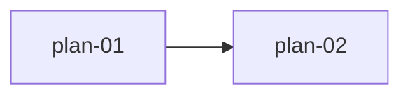

# <需求标题>（Java 后端多模块 Plan 总览）

<!-- atlas:generated document-timestamps:start -->
- 创建时间：`<yyyy-MM-dd HH:mm:ss>`
- 最后编辑时间：`<yyyy-MM-dd HH:mm:ss>`
- 时区：`Asia/Shanghai`
- 编辑记录：
  - `<yyyy-MM-dd HH:mm:ss>`｜创建｜首次生成本文档。
<!-- 后续每次编辑在编辑记录末尾追加“时间｜操作｜摘要”，同步最后编辑时间；不得覆盖历史记录。 -->
<!-- atlas:generated document-timestamps:end -->

- 需求版本：`v<主版本>.<次版本>`
- 后端服务：`<service-id>`
- 开发者：`<姓名或花名>`
- 模块形态：`multi`
- 风险等级：`low|medium|high`
- 状态：`draft|ready|blocked`
- 用户确认：`pending|confirmed`
- 确认人：`<姓名>`
- 确认日期：`YYYY-MM-DD`

> 本文仅是索引。业务规则、技术选型、数据影响、风险、TASK 与验收只写在其责任 `plan-NN-*.md`；外部设计在 `2-external-design/`，跨模块仅引用 Plan、TASK 或 TDEC ID，不复制正文。

## 1. REQ 与模块索引

| REQ | 适用性 | 业务目标或不适用依据 | Plan | TASK | 验收映射 |
| --- | --- | --- | --- | --- | --- |
| REQ-001 | applicable | <业务结果> | `plan-01-<slug>.md` | TASK-BE-001 | <验收要点> |

## 2. 文档拆分索引

| 编号 | Plan | 功能与边界 | 依赖 | Owner | 风险 | 状态 |
| --- | --- | --- | --- | --- | --- | --- |
| 01 | `plan-01-<slug>.md` | <仅本 Plan 的业务边界> | none | <Owner> | <等级> | ready |
| 02 | `plan-02-<slug>.md` | <仅本 Plan 的业务边界> | plan-01:TASK-BE-001 | <Owner> | <等级> | ready |

## 3. 跨 Plan TASK 依赖

只记录由模块 TASK 依赖推导出的跨 Plan 边；没有跨 Plan 依赖时删除图并写 `n/a：<可并行的具体依据>`。

## 4. Plan Gate 检查（未满足项告警）

- [ ] 全部 REQ 已映射到 plan-NN、TASK 或真实不适用依据
- [ ] 模块索引和跨 Plan TASK 依赖与详情完全一致
- [ ] 每个 plan-NN 已独立记录自身业务、技术选型、风险与验收
- [ ] 用户确认已记录；ready 时确认值为 confirmed
