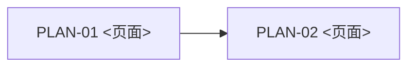

# <需求标题>（前端 UI Plan 总览）

<!-- atlas:generated document-timestamps:start -->
- 创建时间：`<yyyy-MM-dd HH:mm:ss>`
- 最后编辑时间：`<yyyy-MM-dd HH:mm:ss>`
- 时区：`Asia/Shanghai`
- 编辑记录：
  - `<yyyy-MM-dd HH:mm:ss>`｜创建｜首次生成本文档。
<!-- 后续每次编辑在编辑记录末尾追加“时间｜操作｜摘要”，同步最后编辑时间；不得覆盖历史记录。 -->
<!-- atlas:generated document-timestamps:end -->

- 需求版本：`v<主版本>.<次版本>`
- 前端服务：`<service-id>`
- 服务角色：`host|micro-frontend|standalone`
- 原型来源：项目根原型仓库，记录来源路径与已消费变更引用
- 状态：`draft|ready|blocked`

## 来源与输入审计

- PRD：`<路径>`；已消费变更：`<CHG-编号列表，首次追踪无改动时为空>`
- Dev Guide SHA256：`not-provided|<64位SHA256>`（可选）
- 项目静态原型：`<项目配置的原型路径>`（必需）
- 已消费原型变更：`<UI-ADJ 路径、Mock 日志路径#CHG-编号或补建记录路径#iteration-序号>`
- UI Handoff SHA256：`not-provided|<64位SHA256>`（可选）
- 工程 base revision：`<40位revision>`
- <告警或输入缺口；没有则写“无”>

## 范围与分层约定

页面、TASK 和共享边界遵循 [UI Plan 决策规则](../../../skills/frontend/01-ui-plan.md#decision-rules)。

- <本期范围、非范围和关键工程假设>

## 服务边界与跨服务契约

填写当前服务与协作方；源码任务归属遵循上述决策规则。

| 服务 ID | 角色 | 本期责任 | 路由/事件/数据契约 | 是否有独立 UI Plan |
| --- | --- | --- | --- | --- |
| `<service-id>` | `<host / micro-frontend / standalone 三选一>` | `<本服务负责的页面、导航或内容层>` | `<发起或接收的契约；无则写无>` | 是 |
| `<协作服务-id>` | `<角色>` | `<协作边界>` | `<契约>` | 是/否（外部依赖） |

- 导航归属：`<一级、二级或无导航的责任服务>`
- 激活态与深链：`<服务 ID、路由归属及同步方式>`
- 失败降级与回归：`<子应用不可用、无权限或路由失败时的责任与验证>`

## 权限范围与依赖

- 是否涉及权限：`yes|no`；依据：`<PRD REQ/章节与真实工程位置；不涉及时写 not-applicable 并说明原因>`。
- 权限来源：`<已确认角色/授权条件、权限清单或契约、权限获取与判断的真实工程位置；未知项写缺口>`。
- 影响范围：`<页面/路由、操作、数据/字段及对应 PLAN；细项见对应 PLAN 的权限设计>`。
- 跨服务责任与依赖：`<权限由谁提供、如何传递/更新、各服务控制范围与服务端鉴权责任；无则写无>`。
- 新增权限点与待确认项：`<注册/配置责任、依赖 TASK、缺口责任方与回流位置；无则写无>`。

涉及权限时逐项填写；不涉及时保留判定依据，其余项可省略。跨服务权限契约须在相关服务总览中互相引用。

## Plan 清单

| Plan | 服务 ID | 页面 | 路由/承载入口 | 页面目标 | 内含 Task | 前置 Plan | 完成标准 |
| --- | --- | --- | --- | --- | ---: | --- | --- |
| [PLAN-01：<页面名称>](plan-01.md) | `<service-id>` | <页面名称> | <真实路径或承载入口> | <页面目标> | <数量> | <无或PLAN> | <样式、交互、路由与权限验收> |

## 跨 Plan 依赖与批次

1. <批次和并行说明>

| 共享改动 | 负责的页面 PLAN/TASK | 消费页面 PLAN | 依赖与回归范围 |
| --- | --- | --- | --- |
| <组件或基础能力；无则写无并省略表格> | <唯一负责 TASK> | <引用该改动的页面 PLAN> | <实施顺序及各页面回归> |

## Gate 检查（未满足项告警）

- [ ] PLAN 按页面拆分，页面与 PLAN 一一对应；每个 TASK 均归属唯一页面 PLAN
- [ ] 每页覆盖页面样式、交互逻辑、路由、权限和工程边界；不适用项已说明依据
- [ ] 每页已评估组件与逻辑复用，记录真实来源、适配差异、决策理由、改动边界及关联 TASK；扩展/抽取已明确兼容性与回归
- [ ] 跨页面共享改动有唯一负责 TASK，消费页面已记录依赖与回归
- [ ] 本服务 PLAN/TASK 未混入其他服务源码；跨服务契约在协作服务总览中已对齐
- [ ] 工程边界对照已在对应 PLAN 文件按真实页面填写，未留空
- [ ] 涉及权限的 PLAN 已填写权限设计并关联 TASK 验收；不涉及权限已说明依据，权限缺口已如实记录并回流
- [ ] static-page 已规划到真实工程和 production build
- [ ] 待确认项清零或如实标记阻塞；未满足不阻止后续阶段
