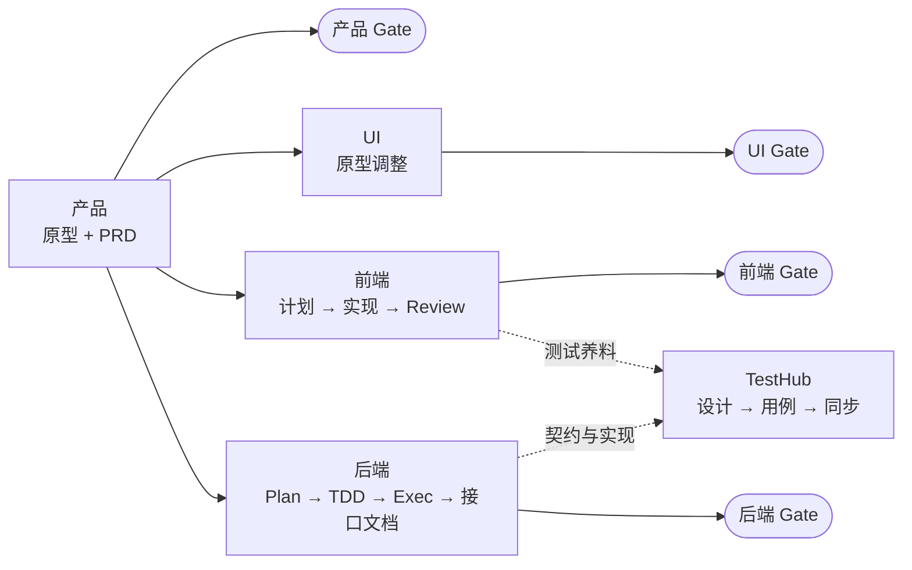

# Mini Harness

> **让团队的研发方式，成为 Agent 的工作方式。**

**Mini-Harness 是团队通用的 Harness Core。** 它把产品、UI、前端、后端、测试与缺陷修复的协作方式，整理成 Agent 可执行的角色工作流、阶段技能、规则、产物模板和校验工具。项目只需锁定一个 Core 版本，就能让 AI 按团队约定的阶段推进需求，并把每一步的产物、证据和确认留在仓库中。

**8 条工作流 · 4 道独立角色 Gate · 项目精确锁定 Core · 机器校验 + 人工确认**

[设计思路](#设计思路) · [核心能力](#核心能力) · [一个需求如何流转](#一个需求如何流转) · [快速开始](#快速开始) · [边界说明](#边界说明) · [仓库结构](#仓库结构)

## 设计思路

每个团队都有自己的研发方式：需求怎样从探索走到 PRD，原型由谁维护，前后端按什么顺序设计、实现和自测，交付需要哪些证据，最后由谁确认。这些经验如果只留在人的脑子里，Agent 每次都要从头猜。

Mini-Harness 的做法是**把方法和事实分开**：

- **方法放在 Mini-Harness**：通用的 workflow、skill、规则、模板和校验器，由团队统一维护、按版本发布。
- **事实放在项目和服务里**：产品事实、需求周期和交付证据由项目 Harness 保存；源码、长期契约和运行事实由服务仓库保存。
- **确认交给真实负责人**：工具负责检查结构和证据，是否通过由各角色负责人明确确认，并记录身份、时间和范围。

这样，同一套方法可以服务多个项目；每个项目也能清楚知道自己用的是哪个版本、做到了哪一步、凭什么算完成。

## 核心能力

| 能力 | 对日常研发的价值 |
| --- | --- |
| **按角色执行** | 产品、UI、前端、后端、TestHub、Bugfix 各有独立工作流和写入边界；职责不清时先询问归属，不跨角色代做。 |
| **分阶段推进** | 每条工作流拆成若干阶段，每个阶段对应一个 skill、明确的产物路径和完成标准，可以从任一阶段进入，不必机械地从头重跑。 |
| **可追溯的需求事实** | PRD 首次交付后，每次修改都追加 `CHG-*` 记录；原型改动通过 Mock 日志、UI 调整文档或补建 iteration 留痕，前后端可以准确记录自己读取过哪些内容。 |
| **四角色独立 Gate** | product、ui、frontend、backend 分别确认、互不依赖；每次确认记录确认人、Git 身份、时间、范围和证据，机器检查不能代替确认。 |
| **版本锁定与校验** | 项目按版本、Git revision 和内容哈希精确锁定 Core；`validate_harness.py` 检查配置、产物结构和锁定是否一致。 |
| **跨仓协作** | 项目 Harness 通过服务目录定位前后端仓库，按服务 ID、路径和 revision 关联交付，不把源码复制进 Harness。 |

这里的 **Harness**，指引导 Agent 工作的约束与执行规则：应该读哪些信息、遵守哪些边界、交付什么证据才能完成。

### 三层归属

| 位置 | 回答的问题 | 保存什么 |
| --- | --- | --- |
| **Mini-Harness**（本仓库） | 团队怎么做研发？ | 角色工作流、阶段技能、规则、模板、Schema、校验器与通用 Hook |
| **项目 Harness** | 这个项目要做什么、做到了哪一步？ | 项目上下文、服务目录、需求周期、PRD、共用原型、阶段产物、`Gate.yaml` |
| **服务仓库** | 代码和契约实际是什么？ | 源码、构建配置、长期接口契约、数据与部署事实 |

不要把具体项目的 PRD 或服务源码放进 Mini-Harness。详见[首次使用与共用约定](使用手册/首次使用与共用约定.md)。

### 角色工作流

| 角色或流程 | 主线 | 入口 |
| --- | --- | --- |
| 产品 | Mock 原型 → 生成或修订 PRD → 反问收束并完成产品 Gate | [product-design](.harness/workflow/product-design-workflow.md) |
| UI | 原型调整 → 调整文档与 Handoff → UI Gate | [ui-design](.harness/workflow/ui-design-workflow.md) |
| 已有页面原型补建 | 源码与页面取证 → 还原规格 → 静态原型 → 验证与交接 | [prototype-reconstruction](.harness/workflow/prototype-reconstruction-workflow.md) |
| 前端 | UI 计划 → UI 实现 → API 计划 → API 实现 → Review → 测试养料 → 前端 Gate | [frontend](.harness/workflow/frontend-workflow.md) |
| 后端 | Plan → 外部设计 → TDD → Exec → 本地接口测试 → 接口文档 → Review → 外部配置清单 → 后端 Gate | [backend](.harness/workflow/backend-workflow.md) |
| 前端 Mock | 评估 → 搭建 → 场景数据 → 接入 → 验证 | [frontend-mock](.harness/workflow/frontend-mock-workflow.md) |
| TestHub | 测试设计 → 用例生成 → 校验与同步 → 按需执行 | [testhub](.harness/workflow/testhub-workflow.md) |
| Bugfix | 记录与根因定位 → 修复与验证 → 汇总复盘 | [bugfix](.harness/workflow/bugfix-workflow.md) |

角色只在用户明确选择后进入或切换，路由规则见 [AGENTS.md](AGENTS.md)。Jenkins 是独立的按需能力，不属于任何工作流，见 [Jenkins skill](.harness/skills/delivery/jenkins.md)。

## 一个需求如何流转



举个例子：产品在项目共用原型里探索一个新页面，再生成 `v1.2` 的 PRD。PRD 首次交付后进入修订追踪，之后每次改动都追加一条 `CHG-*`。前后端开始工作时，在 `execution.yaml` 中记录自己读取了哪份 PRD、原型以及截至当时的变更引用。

各角色完成自己的阶段产物后，由负责人通过 `role_gates.py` 确认本角色 Gate。之后 PRD 如果又新增了 `CHG-005`，旧的确认不会被自动作废，其他角色的 Gate 也不会被自动重置。复核时可以准确看到“上次确认之后新增了哪些变更”，再由各角色决定哪些部分需要重新处理。

四个 Gate 之间没有先后依赖。角色内部的阶段有顺序，但前端不需要等产品 Gate 确认才能开始规划。TestHub 只负责测试，不设第五道 Gate。详见 [Gate 协议](.harness/rules/review-gates.md)和[产品追溯规则](.harness/rules/product-semantics-and-traceability.md)。

## 快速开始

### 1. 接入项目

需要 Python 3（依赖见 [requirements.txt](.harness/tools/requirements.txt)）、Git，以及能加载 `AGENTS.md` 的 Coding Agent。Hook 采集的接入以 Codex 为准。

1. 将 [`project-harness-template/`](project-harness-template/README.md) 中的 `AGENTS.md`、`.gitignore`、`.codex/`、`.harness/`、`Gate.yaml` 和 `原型仓库/` 复制到项目 Harness 根目录。已有项目先对比再合并，不要覆盖已有配置。
2. 在 `.harness/harness.yaml` 中填写项目 ID、名称，以及 Core 的 `localPath`、`version`、`revision`、`contentHash`，这些值必须来自同一个真实的 Core 提交。
3. 按实际服务填写 `.harness/projectContext/`。模板中的示例服务和占位符不是工程事实。
4. 同步 `Gate.yaml` 的 `projectId`，所有角色初始均为未确认。

### 2. 发起一次任务

在项目 Harness 中打开 Agent 会话，用自然语言说明角色和范围：

```text
我负责<角色>。项目 Harness 位于<路径>，需求版本是<版本>，目标服务是<服务 ID>。
请先读取项目 AGENTS.md、harness.yaml 和项目锁定的 Mini-Harness，
确认当前阶段和已有产物，再按对应 workflow 执行<本次任务>。
完成后返回产物位置、实际验证结果、缺口和下一步交接对象。
```

Agent 会从项目 `AGENTS.md` 进入 Mini-Harness 入口，按角色读取 workflow，再逐阶段读取 skill、规则和模板。各角色的可复制指令见[使用手册](使用手册/使用手册导航.md)。

### 3. 校验

```powershell
# Core 自检
python .harness/tools/validate_harness.py --core-only

# 项目校验（发版、项目 pin 或正式 Gate 前）
python .harness/tools/validate_harness.py --project-root <实际项目根>
```

Gate 和 PRD 修订分别使用 `role_gates.py`、`prd_revision.py`，参数可通过 `--help` 查看。

## 边界说明

- **机器检查不等于确认**：校验通过、Hook 存在或模板齐全，都不代表业务 Gate 已确认、外部系统已接通或已获得发布许可。
- **角色确认不等于上线**：Gate 确认不代表测试完成、发布或部署；外部待办必须如实记录，不能写成已执行。
- **角色不扩大权限**：产品和 UI 只修改项目共用原型，不修改真实前后端代码；TestHub 远程同步和执行需要明确授权及真实配置；Jenkins 不由 Review、Gate 或 Hook 自动触发。
- **采集默认只存本地**：项目 Hook 采集项目、Git 用户、脱敏并截断后的问答、Token 用量以及访问过的 Mini-Harness 资源；未配置 `HARNESS_TELEMETRY_URL` 时只写本地队列，不上传。Hook 不承担工作流或 Gate 的强制执行。详见 [Hook 说明](.harness/hooks/README.md)。
- **凭据不进仓库**：真实凭据只保存在被忽略的本地配置中，不进入模板、文档、命令参数或日志。

## 仓库结构

| 目录 | 职责 |
| --- | --- |
| [`.harness/`](.harness/README.md) | Core 资源根；`harness.yaml` 与 `version.lock` 定义元数据、版本和内容锁 |
| [`.harness/workflow/`](.harness/workflow) | 各角色与专项流程的阶段编排、输入和写入边界 |
| [`.harness/skills/`](.harness/skills) | 阶段执行方法及专项能力 |
| [`.harness/rules/`](.harness/rules) | 通用执行约束、状态、追溯和工程规则 |
| [`.harness/template/`](.harness/template) | 需求与阶段交付物模板 |
| [`.harness/tools/`](.harness/tools) | 配置与产物校验、Gate、PRD 修订等工具及测试 |
| [`.harness/hooks/`](.harness/hooks/README.md) | 可由项目接入的通用采集器与 Hook 实现 |
| [`project-harness-template/`](project-harness-template/README.md) | 新项目脚手架 |
| [`使用手册/`](使用手册/使用手册导航.md) | 按角色组织的使用说明 |
| [`docs/`](docs/core-maintenance.md) | Core 维护约定 |

## 文档入口

- [Mini-Harness 项目入口](AGENTS.md)：角色工作流路由、能力边界与目录说明
- [Core 使用导航](.harness/README.md)：各主题的权威定义位置与工具入口
- [使用手册](使用手册/使用手册导航.md)：产品、UI、前端、后端、测试、运维、项目维护者与 Core 维护者
- [项目接入与执行约定](.harness/rules/project-execution.md)
- [Core 维护约定](docs/core-maintenance.md)：修改 Mini-Harness 自身时阅读

当前 Core 版本和内容锁以 [`.harness/version.lock`](.harness/version.lock) 为准；项目实际采用的版本以项目配置中的精确 pin 为准。
